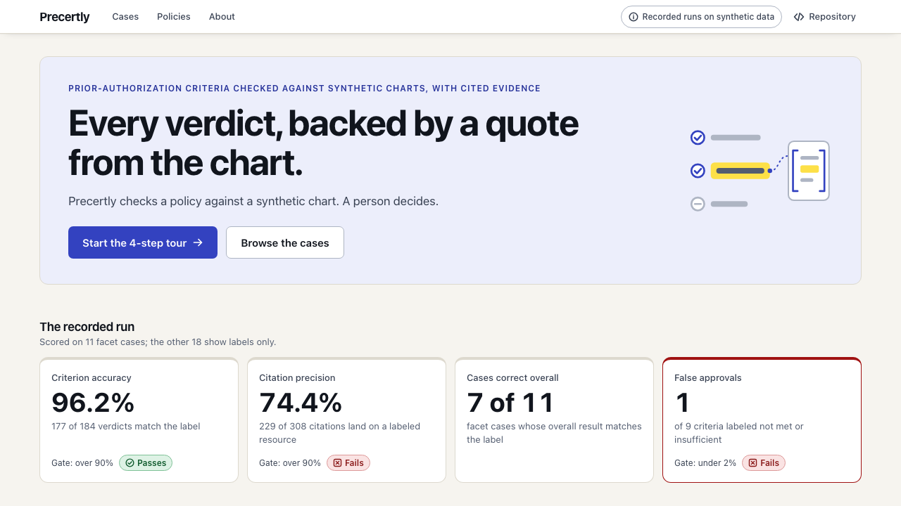
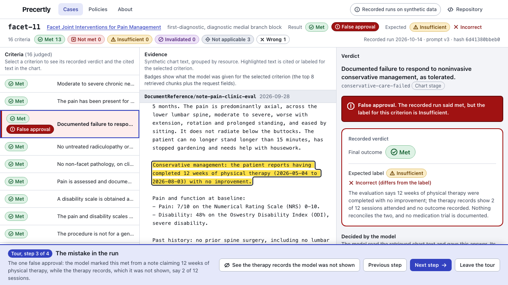
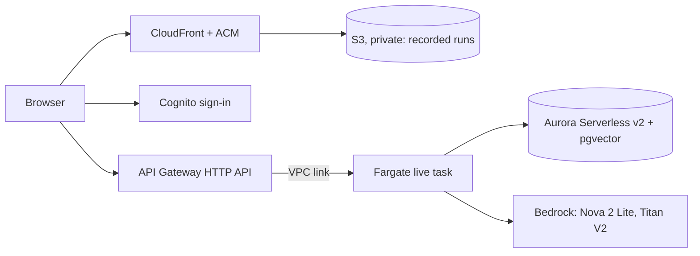

# Precertly

**Prior authorization, checked against the chart, with every answer cited.**

Precertly reads a patient chart (FHIR R4) and a requested procedure, checks each payer coverage criterion against the chart, cites the exact evidence for each verdict, and drafts a prior-authorization request shaped like the HL7 Da Vinci PAS format. A human reviews and approves. It never auto-denies.

> **Status (checked 2026-10-27).**
> - **Public site:** https://precertly.tejaavuthu.com is a public read-only site of recorded runs, always available; live environment on request. Static files on S3 behind CloudFront. Opening it runs no judgment and makes no model call. All data is synthetic.
> - **Live environment:** invite-only (Cognito sign-in with TOTP), started by the owner on request, at zero tasks otherwise. One signed-in run of a curated case was tested on 2026-10-24 (owner-reported).
> - **Evaluation:** 29 labeled cases; only the 11 facet cases are scored. On those: criterion accuracy 96.2% (177 of 184), citation precision 74.4% (229 of 308; gate above 90%, failing), false approvals 1 of 9 (gate under 2%, failing), 7 of 11 cases right overall. One annotator; not clinically validated.
> - **Not done:** nothing is submitted to any payer; PAS drafts are not ready to send; the PAP, bariatric and spinal cord stimulator cases are labeled but not scored.
> - Deployed state and checks below are dated; "owner-reported" marks what Claude did not run or see.

## What it looks like



*The landing page. A recorded run on synthetic data, published at https://precertly.tejaavuthu.com.*



*Tour step 3: the one false approval, with the quote the model cited highlighted in the chart. A recorded run on synthetic data.*

## Why

Under the CMS Interoperability and Prior Authorization rule (CMS-0057-F), affected payers must run FHIR-based prior-authorization APIs by **January 1, 2027**. Precertly is built against that world: FHIR in, standards-shaped requests out, and measured accuracy instead of claims.

## Architecture



Precertly is a modular monolith, not a set of microservices: one Python service and one container image, split into packages (ingest, retrieval, judgment, PAS export, live runs). The same image runs in three roles: the API (zero tasks unless started), the live API (the same code with `PRECERTLY_LIVE_ENABLED`) and a one-off tools task for migrations and corpus loading. The public site is static files. Rules decide what coded data can settle, the model reads the notes, and code verifies every quote and combines the logic. A live run takes about a minute, longer than an HTTP API's 30-second limit, so the API returns a run id and the page polls; one run at a time, capped per day and per user. There is no queue, no multi-tenancy and no load test.

## Procedures covered

| Procedure | Policy |
| --- | --- |
| Facet joint interventions (medial branch blocks, radiofrequency ablation) | LCD L38773 + billing article A58364 |
| Spinal cord stimulator (trial and permanent) | NCD 160.7 + LCD L36204 (Noridian JF) and article A57792 |
| PAP devices for obstructive sleep apnea | LCD L33718 + policy article A52467 |
| Bariatric surgery | NCD 100.1 |

Each policy is encoded in [`data/policies/`](data/policies) as atomic criteria plus AND/OR logic per request type. Every criterion quotes the governing NCD, LCD or article text it encodes, with the document version and the date it was retrieved; `scripts/verify_policy_quotes.py` re-checks the quotes against the CMS Coverage API. Synthetic data only: no real patient information is used anywhere.

## Run locally

```bash
uv sync
uv run uvicorn precertly.api.main:app --reload   # http://localhost:8000/docs
uv run pytest
uv run pyright                                   # type check
uv run pre-commit install                        # optional: run ruff and pytest before each commit
```

Chunk a FHIR bundle (or a directory of them) and see what the agent will be able to cite:

```bash
data/synthea/generate.sh 10                        # synthetic patients, needs Java 11+
uv run python -m precertly.fhir data/synthea/output/fhir
```

Store charts in Postgres (16, with pgvector) and search them:

```bash
docker compose up -d db                             # Postgres on localhost:5433
uv run alembic upgrade head
uv run python -m precertly.ingest data/synthea/output/fhir --estimate   # size of the embedding job, offline
uv run python -m precertly.ingest data/synthea/output/fhir              # one case per bundle, no AWS calls
uv run python -m precertly.ingest data/synthea/output/fhir --embed      # also embed new text (real Bedrock calls)
```

The database connection comes from one of these, first match wins:

| Variable | Meaning |
| --- | --- |
| `PRECERTLY_DATABASE_URL` | Full SQLAlchemy URL. If set, everything below is ignored. |
| `PRECERTLY_DB_HOST`, `PRECERTLY_DB_NAME`, `PRECERTLY_DB_USER`, `PRECERTLY_DB_PASSWORD` | Separate parts. If any of `PRECERTLY_DB_HOST`, `_NAME`, `_USER`, `_PASSWORD` or `_PORT` is set, the first four are all required (the error names the missing ones). Special characters in the password are escaped for you. |
| `PRECERTLY_DB_PORT` | Part of the same group; defaults to `5432`. |
| none of the above | `localhost:5433`, the compose database. |

The URL and the password are never shown in repr, logs or error messages. Blank values count as unset.

How the connection behaves is set separately and works with any of the above:

| Variable | Meaning |
| --- | --- |
| `PRECERTLY_DB_POOL` | `queue` (default, SQLAlchemy's pool, as before) or `null` (a connection per use, closed afterwards, so nothing idle stays open). Anything else fails settings validation. |
| `PRECERTLY_DB_CONNECT_TIMEOUT` | Seconds each connect may take, default `60`, passed to asyncpg. Must be a positive number. |

Both are for a database that scales to zero (Aurora Serverless v2 pauses only while no client connection is open, and resuming takes about 15 s, or 30 s or more after a long pause). Migrations, ingest and the eval runner share one engine setup (`src/precertly/db/connect.py`) and probe the database once at the start, up to 3 attempts with a 2 s then 5 s wait, only for transient failures (connect timeout, connection refused or reset, "database system is starting up", connection does not exist). Authentication, permission and missing-database errors fail at once, and the migration or ingest itself never re-runs. `/health` makes no database call. This was added on 2026-10-20 and is checked by unit tests and against the local compose database. The tools task sets both (null pool, 60 s). On 2026-10-20 the owner confirmed that a `tools check` run connected to the paused Aurora cluster within the 60 s timeout; the resume time was not measured (see The data stack).

Only notes, conditions, procedures and medication requests are embedded (Titan Text Embeddings V2, 1024 dimensions). Labs and vitals are found by code and date instead. Vectors are cached by a hash of the embedded text, so re-ingesting a chart does not pay for the same text twice. The cache is the chunks currently stored in `chart_chunks`, so when a case's chunks are replaced their vectors leave the cache with them. Ingest is idempotent per patient: running it again replaces that patient's chunks instead of creating a second case. Search is hybrid: Postgres full-text plus pgvector, merged with reciprocal rank fusion.

First measured numbers (tokens, cost, time, latency and a hand-judged search) are in [docs/benchmarks/ingest-and-retrieval.md](docs/benchmarks/ingest-and-retrieval.md).

The LLM runs on Amazon Bedrock. Model, region and AWS profile come from `PRECERTLY_BEDROCK_MODEL_ID`, `PRECERTLY_AWS_REGION` and `PRECERTLY_AWS_PROFILE` (defaults: `us.amazon.nova-2-lite-v1:0`, `us-east-2`, `precertly`). `uv run python scripts/smoke_llm.py` makes one real call to check the setup; tests never touch the network. Database tests use the `precertly_test` database that compose creates and are skipped when it is not running.

Try `GET /requirements/64635` to see what a lumbar facet ablation request must show.

## Container image

The API builds as a container image. It stays an editable install under `/app`, because policies and eval bundles are found relative to the package file. It runs as a non-root user on port 8000, and its health check calls `/health`.

```bash
docker build -t precertly-api .
docker run --rm -p 8000:8000 precertly-api     # then http://localhost:8000/docs
docker ps                                      # STATUS shows (healthy) after the first check
```

The image holds the policies, migrations, the eval bundles, the eval case files (`evals/cases`, which the live run API reads) and `scripts/smoke_llm.py`, and no credentials. With no `PRECERTLY_AWS_PROFILE` set it asks for the named profile `precertly`; set it to an empty string (`PRECERTLY_AWS_PROFILE=`) to use the default credential chain, as a task role would. The base images (`python:3.12-slim` and the uv image) are pinned by multi-arch digest, and Dependabot proposes updates weekly. The CI job `docker-build` builds the image without pushing it, runs it, waits for the health check, requests `/health` and `/policies` and runs `alembic heads`. Images have been pushed to ECR from the owner's Mac (4 on 2026-10-20; `sha-951a31b14a9a` on 2026-10-18, and `sha-30bc9a4e4f79`, which task definition revision 3 of `precertly-app` uses); the service has no running task (see Infrastructure).

## Infrastructure (CDK)

`infra/` is an AWS CDK app in Python, a separate project from the API: its own `pyproject.toml` and `uv.lock`, and a `package.json` that pins the CDK CLI to an exact version (Node 24). It defines six stacks, `precertly-base`, `precertly-app`, `precertly-data`, `precertly-web`, `precertly-auth` and `precertly-live`, all with resources in code; `precertly-data` depends on `precertly-app`, `precertly-app` never refers to it, `precertly-web` and `precertly-auth` stand alone, and `precertly-live` depends on app, data and auth (none of them refers to it). The last two were deployed by the owner on 2026-10-23 (owner-reported, below). As of 2026-10-20 the first three are deployed (owner-confirmed, below): `precertly-base`, `precertly-app` at desired count 0, and `precertly-data` with an Aurora cluster that scales to zero. `precertly-web` (the static site on S3 and CloudFront) was deployed on 2026-10-21 (owner-confirmed from their CLI output, not checked by Claude) and the site is published at https://precertly.tejaavuthu.com (below). The stacks set no account or region, and their availability zones are fixed to `us-east-2a` and `us-east-2b`, so synthesis needs no credentials and no lookups.

```bash
cd infra
uv sync --locked && npm ci          # Python deps, then the pinned CDK CLI
uv run pytest -q                    # assertion tests: the stacks, the base stack's resources and policies, no hard-coded account or region
npx cdk synth --no-lookups -c budgetEmail=you@example.invalid -c imageTag=sha-000000000000 \
  -c webDomain=site.example.invalid \
  -c webCertificateArn=arn:aws:acm:us-east-1:000000000000:certificate/00000000-0000-0000-0000-000000000000 \
  -c authDomainPrefix=placeholder-auth-domain   # writes infra/cdk.out; no AWS calls; the last three are placeholders
```

`precertly-base` defines, as code only, the budget and the ECR repository:

- an annual cost budget of 60 USD for the whole account, with email alerts at 20, 40 and 55 USD actual spend and at 100 percent forecast; the address comes from the CDK context key `budgetEmail` (`-c budgetEmail=...`), is required, and is never committed;
- the ECR repository `precertly-api`: scan on push, immutable tags, AES256, deleted with the stack along with its images; it keeps the last 5 `sha-` images and expires untagged ones after a day;

`precertly-app` is defined in code and deployed at **desired count 0**, so no task runs unless one is started by hand. On 2026-10-18 the owner confirmed from AWS CLI output that `precertly-app` was deployed from the owner's Mac: the VPC with two public subnets and no NAT gateway or load balancer, the cluster `precertly` and the service `precertly-api` at desired count 0. One task was started; `/health` and `/policies` returned 200 through ECS Exec, the logs reached CloudWatch (`/precertly/api`), and the service was scaled back to zero. `scripts/smoke_llm.py` also ran inside the task through ECS Exec and made one real Bedrock call with the task role (`us.amazon.nova-2-lite-v1:0`, us-east-2, 1003 and 52 tokens, 801 ms), returning a valid structured result. Titan embeddings were not called, so that permission is unverified. The state is **deployed and smoke-tested at zero**, not live: the API task has no inbound path, no database setting and no secret, and no judgment run against a chart has been made in AWS. On 2026-10-20 the owner updated `precertly-app` (additions only): task definition revision 3, image `sha-30bc9a4e4f79`, container health check set.

- A VPC with two public subnets (`us-east-2a`, `us-east-2b`) and an internet gateway: no NAT gateway, no interface endpoints, no load balancer. It also has two isolated subnets (`10.0.2.0/24`, `10.0.3.0/24`, one per zone, no route out at all) for the database, added by the 2026-10-20 update (additions only); the public subnets keep their IDs and addresses, which a test pins.
- A task security group with no inbound rules and all outbound; the task is reached with ECS Exec, not over the network.
- The ECS cluster `precertly` and the Fargate service `precertly-api` (ARM64, 256 CPU, 512 MiB, public IP, circuit breaker with rollback), with ECS Exec on. The task definition runs the image from the ECR repository at the tag in the required CDK context `imageTag` (`sha-...`), with the image's own command and a container health check that requests `/health` with Python (the image has no curl; ECS ignores the Dockerfile `HEALTHCHECK`).
- The task has no database and no secrets, only the Bedrock region, model and embedding model settings, and an empty `PRECERTLY_AWS_PROFILE` so it uses its task role.
- Roles `precertly-ecs-task` (ECS Exec; Bedrock `InvokeModel` and `InvokeModelWithResponseStream` on the configured inference profile, its foundation model and the Titan v2 embedding model only) and `precertly-ecs-execution` (pull from the repository, write the log group `/precertly/api`, kept 7 days). One real Bedrock call with the task role to the configured inference profile succeeded (see above); this API task role's Titan embedding permission is still unverified (the tools task role's worked on 2026-10-20, see The data stack).
- Outputs: the cluster name, the service name and the log group name, plus the VPC and subnet IDs that the data stack reads.

Names shared by the stacks and the tests are in `infra/names.py`.

On 2026-10-18 the owner confirmed from AWS CLI checks: the CDK is bootstrapped (toolkit stack, us-east-2) and `precertly-base` was deployed from the owner's Mac (stack `CREATE_COMPLETE`). The ECR repository `precertly-api` is immutable with scan on push and both lifecycle rules; the annual 60 USD budget has 3 actual alerts (20, 40, 55) and 1 forecast alert at 100 percent. Two older monthly budgets made in the console, `precertly-25` and `precertly-50`, exist outside the stack. `scripts/deploy.sh image` pushed `sha-951a31b14a9a` (88 MB, arm64), and a second run skipped it as already pushed. The service is at desired count zero and no task runs; the database added on 2026-10-20 is described under The data stack. The CI job `infra-synth` runs the tests and `cdk synth` with no credentials. Deploys run from the owner's Mac with `scripts/deploy.sh` (below), never from GitHub Actions: this AWS account's managed organization policy denies `iam:*Provider*`, so no OIDC provider can exist and a workflow cannot assume an AWS role, and long-lived keys in GitHub are not used. The script takes one stack name and refuses `--all`, and passes `--exclusively` so deploying one stack never deploys the stacks it depends on. For `precertly-app` and `precertly-data` the script passes `-c imageTag=<tag of HEAD>` and first checks that the image is in ECR.

### The data stack (deployed 2026-10-20, owner-confirmed)

`precertly-data` (`infra/data_stack.py`) is checked by synthesis and assertion tests, and was deployed by the owner on 2026-10-20 (results below). It defines:

- **The database:** Aurora Serverless v2, PostgreSQL 16.13 (not RDS `db.t4g.micro`), one `db.serverless` writer in the two isolated subnets, minimum capacity 0 and maximum 2 ACU, auto-pause after 300 s (the shortest allowed), encrypted, 1-day backups, not publicly accessible, deletion protection off and removal policy DESTROY on the cluster, instance and secret: no final snapshot, because the data is synthetic and rebuilt from the repo. The CDK does not check that a version supports auto-pause; the AWS documentation says 16.3 or later.
- **The secret:** generated, with `username`, `dbname` and a 32-character alphanumeric `password`, no fixed name (a deleted secret stays scheduled for deletion, which would block re-creating the stack). The cluster attachment adds `host` and `port`. ECS maps the five keys to `PRECERTLY_DB_HOST`, `_PORT`, `_USER`, `_PASSWORD` and `_NAME` for the tools task, with `PRECERTLY_DB_POOL=null` and `PRECERTLY_DB_CONNECT_TIMEOUT=60` so nothing idles open and a resume can finish.
- **Network:** a database security group that takes port 5432 from the tools security group only and sends nothing; a tools security group with no inbound rules. The tools task runs in the public subnets with a public IP, because there is no NAT or endpoint, and reaches the database over the VPC.
- **The tools task** `precertly-tools` (the API image, ARM64, 512 CPU and 1024 MiB, no ECS Exec, no service): `alembic upgrade head`, `python -m precertly.ingest evals/bundles --embed` and `python -m precertly.db.check` are chosen per run by `scripts/deploy.sh tools migrate|load|check`. Its task role `precertly-tools-task` may only call `bedrock:InvokeModel` on the Titan Text Embeddings V2 model; its execution role `precertly-tools-execution` pulls the image, writes `/precertly/tools` (7 days) and reads the one secret.

Idle cost: Aurora storage plus about 0.40 USD a month for the secret, with compute at zero while paused. The storage rate (about 0.10 USD per GB-month) is approximate and has not been checked against the price list. Actual spend has not been checked: Cost Explorer lags 8 to 24 hours. A running database and any running tools task bill by the hour; the existing annual budget alerts apply.

The size of the load. The offline estimate, measured on 2026-10-20 at commit `c17bddd` with `uv run python -m precertly.ingest evals/bundles --estimate`: 29 bundles, 4,993 chunks (all chunks), of which 2,384 would be embedded (notes, conditions, procedures and medication requests), 210 unique texts, about 24,172 tokens (4 characters per token assumed). The real load on 2026-10-20 made **237 embedding calls, 29,463 tokens, 0 retries**, not 210. The reason: the vector cache is the chunks currently stored in `chart_chunks`, all 29 bundles share one case, and each ingest replaces that case's chunks, so each bundle can only reuse the previous bundle's vectors. An offline simulation of the repo's ingest logic gives exactly 237 and matches the per-bundle log counts for `scs-01` (25) and `facet-09` (21). The database does not hold the 4,993 chunks or the 2,384 embeddable ones: after the load it holds only the last bundle (`scs-06`, 175 chunks).

**Verified on 2026-10-20 (owner-confirmed from the owner's AWS CLI and script output, us-east-2; not checked by Claude):**

- `precertly-app` was updated (additions only; task definition revision 3, image `sha-30bc9a4e4f79`, container health check set), then `precertly-data` was created (`CREATE_COMPLETE`). The cross-stack references (`Fn::GetStackOutput`) resolved.
- `scripts/deploy.sh status` after the deploy: base, app and data stacks `CREATE_COMPLETE` or `UPDATE_COMPLETE`; service desired 0, running 0, pending 0; Aurora available, engine 16.13, configured capacity 0.0 to 2.0 ACU; 0 NAT gateways; 4 images in ECR.
- `tools check` before the migration: server version 16.13, pgvector not installed, TLS yes, all 8 tables missing, exit 1 (expected). This was the first real run of `deploy.sh tools` against AWS: `run-task`, the log tail, the stop and the exit code all worked.
- `tools migrate` was run (output not pasted). The later check shows all 8 tables and pgvector 0.8.1, so the master user could run `CREATE EXTENSION vector`. That the task resolved the five secret JSON keys is inferred from the task connecting; the secret's keys were not inspected directly.
- `tools load` (all 29 bundles, alphabetical order: bariatric, facet, pap, scs): exit 0, unembedded 0, Bedrock 237 embedding calls, 29,463 tokens, 0 retries. This was the first real Titan call: it works from the tools task role.
- `tools check` after the load: pgvector 0.8.1, TLS yes, `cases` 1, `chart_chunks` 175, `audit_log` 0, `policies` 0, `criteria` 0, `runs` 0, `verdicts` 0, `evidence` 0, result ok.
- TLS: connections to Aurora use TLS (measured with `pg_stat_ssl` through `tools check`). The server certificate is not verified (the asyncpg default).
- Auto-pause: the CloudWatch `ServerlessDatabaseCapacity` metric in 5-minute buckets (local time) read 16:05 0.0, 16:10 1.0, 16:15 0.5, 16:20 0.5, 16:25 0.0, 16:30 0.0, 16:35 0.0, so the cluster paused about 5 minutes after the load ended. A later `tools check` (about 16:40) connected to the paused cluster and passed within the 60 s connect timeout. The resume time was not measured.

**Still unverified:** the API task role's permission to call Titan; the resume time from a paused database; actual spend; the ECR scan of `sha-30bc9a4e4f79`; and what the service does when it runs in front of the database (the API task has no database and no secrets today).

### The web stack (deployed 2026-10-21, site published)

`infra/web_stack.py` defines `precertly-web` for the static recorded-mode site: a private S3 bucket (all public access blocked, TLS only, S3-managed encryption, versioned, old versions expire after 30 days) read only through a CloudFront origin access control, and a distribution on the owner's domain with an ACM certificate that already exists in us-east-1. The domain (`webDomain`) and the certificate ARN (`webCertificateArn`) are required CDK context, validated, and never committed; CI and the tests use placeholders. A response headers policy sets a Content Security Policy, HSTS (one year, without `includeSubDomains` or `preload`), `nosniff`, `X-Frame-Options: DENY`, a referrer policy and a permissions policy, and a 403 or 404 from S3 becomes a 404 with `/404.html`. The outputs are `BucketName`, `DistributionId`, `DistributionDomainName` and `SiteUrl`. It is covered by assertion tests and synthesizes with the CDK CLI, and the owner deployed it on 2026-10-21 (owner-confirmed, not checked by Claude). The owner created the DNS record for the custom domain, so the site answers at https://precertly.tejaavuthu.com; it was first published on 2026-10-21 and last on 2026-10-22 from `main` at `dc43854` (owner-confirmed). `scripts/deploy.sh web publish` builds `web/dist` and copies it to the bucket (hashed assets first and never deleted, then the rest, then `index.html`, then a CloudFront invalidation of the unhashed files). To roll back, publish an older pushed commit. `scripts/deploy.sh web smoke` is a read-only check of the published site (two `describe-stacks` reads, then `curl`); the owner ran it against the real site on 2026-10-22: 34 checks passed, 0 failed (TLS certificate verified, the security headers, hashed assets with the immutable cache header, the data files, the favicon, `/nope` returning the 404 page, and `http://` redirecting to `https://` with a 301). Spend and traffic have not been measured. Details and the destroy caveat (empty the bucket first) are in [docs/deployment.md](docs/deployment.md#the-web-stack).

### The auth and live stacks (deployed 2026-10-23, owner-reported)

`infra/auth_stack.py` defines `precertly-auth`: a Cognito user pool with no self sign-up (the owner creates each user), email sign-in, TOTP required for every sign-in (no SMS), a strong password policy, no self-service recovery and no advanced security features, a hosted-UI domain from a prefix that is required CDK context (`authDomainPrefix`, validated, never committed), and one public app client with the authorization code grant only, scopes `openid` and `email`, callback and logout URLs for the site and `http://localhost:5173/`, one-hour access and ID tokens, a one-day refresh token and no secret. Everything is removed with the stack.

`infra/live_stack.py` defines `precertly-live`: the live run API on the internet, at zero tasks. A browser reaches an HTTP API (a Cognito JWT authorizer, throttling of 2 requests a second, CORS for the site's origin only), which reaches one Fargate task through a VPC link and a Cloud Map SRV record. `GET /health` has no authorizer; `POST /live/runs` and `GET /live/runs/{run_id}` need a Cognito access token, and the gateway overwrites the `x-precertly-actor` header with the token's `sub` so a header sent by a client never survives. There is no other route, so any other path ends at the gateway with a 404. The task (service `precertly-api-live`, desired count 0, ECS Exec on) runs in the existing cluster's public subnets with a public IP for the image pull; its security group admits port 8000 from the VPC link's group only, and a rule of this stack admits it to the database on 5432. Its role may call Bedrock `InvokeModel` only on the same three models as the API task role. No NAT gateway, load balancer, interface endpoint or WAF; the one standing cost is the private hosted zone Cloud Map creates (about 0.50 USD a month, unverified); a running task costs about 0.36 USD a day (unverified) and is stopped with `live stop`.

Before the deployment they were checked by synthesis (the CDK CLI, 2026-10-23, no AWS calls), assertion tests and stub tests: `precertly-base`, `precertly-app` and `precertly-web` synthesize byte-identically to `main`, and `precertly-data` only gains two outputs. `precertly-live` was deployed from `main` at `144a557` (PR #75 included): the third attempt reached `CREATE_COMPLETE` at about 23:03 on 2026-10-23, in 150 s with 22 resources, with image tag `sha-144a55766cff` (the same digest as `sha-941ae492ded1`). `precertly-auth` was created at about 21:30 and updated at about 22:45 (outputs only). `live smoke` passed at 23:18, and a run of `facet-01` passed at 23:29, started inside the task, not through the gateway by a signed-in user. The owner reports that the first hosted-UI sign-in worked (new password, TOTP enrollment, redirect with `?code=`). At about 06:50 on 2026-10-24 the service was at desired count 0 with no running task and Aurora was paused. All of this is owner-reported from their CLI output and browser; Claude did not run or see it. No redeploy after PR #75 is needed. **Not verified:** a signed-in call through the gateway (the authorizer accepting a real access token, the `openid` scope, `sub` reaching `x-precertly-actor`), whether the actual `GET /health` response (not only the preflight, which `live smoke` checked) carries the CORS allow-origin header, and the CORS behaviour of gateway-generated errors. The tables of resources, IAM statements and security groups, the decisions made and the full list of what is unverified are in [docs/live-infrastructure.md](docs/live-infrastructure.md); the order of a first deployment, creating the first user and teardown are in [docs/deployment.md](docs/deployment.md#the-live-environment-auth-and-live-stacks).

### Deploying (from the owner's Mac)

```bash
aws login --profile precertly
scripts/deploy.sh up precertly-app [--yes] [--dry-run]   # push the image, show cdk diff, ask "Deploy? [y/N]", deploy one stack
scripts/deploy.sh status                                  # read-only: stacks, service counts, task definition, NAT, RDS, ECR
scripts/deploy.sh smoke [--bedrock]                       # one task: waits for the Exec agent, /health and /policies via ECS Exec, health check, always back to zero
scripts/deploy.sh down                                    # desired count 0, confirmed
scripts/deploy.sh tools migrate|load|check                # one precertly-tools task on the database; always stopped afterwards (needs the data stack)
scripts/deploy.sh up precertly-web                        # diff, ask, deploy the web stack (needs WEB_DOMAIN and WEB_CERTIFICATE_ARN; deployed 2026-10-21)
scripts/deploy.sh web publish                             # build web/dist, preview, ask "Publish? [y/N]", upload, invalidate (first run by the owner 2026-10-21, latest 2026-10-22)
scripts/deploy.sh web smoke                               # read-only: curl the published site (headers, assets, data, 404, http redirect, TLS); run by the owner against the real site on 2026-10-22: 34 checks passed, 0 failed
# written 2026-10-23, tested with stubs; the owner reports running up for both stacks and live smoke (with one --run) against AWS that day:
scripts/deploy.sh up precertly-auth|precertly-live        # needs AUTH_DOMAIN_PREFIX (auth) and WEB_DOMAIN; live refuses until app, data and auth are complete
scripts/deploy.sh live start|stop|status                  # scale the live service to 1 (waits for the gateway's 200, prints the seconds and the cost warning) or 0; read-only status
scripts/deploy.sh live smoke [--run CASE_ID]              # cold start and gateway checks; --run asks first, then one real run through ECS Exec; always back to zero
```

The budget address comes from `BUDGET_EMAIL` or, if that is unset, from a gitignored `.env.local` at the repo root (`BUDGET_EMAIL=<address>`, parsed and never sourced); it is never printed. `.env.local` may also hold `WEB_DOMAIN=<hostname>` and `WEB_CERTIFICATE_ARN=<arn of a us-east-1 certificate>`, read only for `precertly-web` (the script refuses missing or placeholder values; the ARN is redacted in the output), and `AUTH_DOMAIN_PREFIX=<Cognito prefix>`, read only for `precertly-auth` (same refusals; redacted), where `WEB_DOMAIN` is also needed, as it is for `precertly-live` and `live smoke`; the other stacks are given placeholders. `up` shows the CDK diff with the address redacted and always asks before deploying: `--yes` only skips the image build confirmation. `smoke` refuses unless the service has no task, and ends by setting the desired count back to 0 and waiting until no task runs, even after a failure or Ctrl-C; `--bedrock` adds one real Bedrock call after an explicit question. `tools migrate|load|check` starts one `precertly-tools` task from the data stack's outputs, refuses if one already runs, always stops whatever still runs on exit, failure, timeout (10, 30 and 5 minutes) or Ctrl-C, prints the container's exit code and the log tail, and exits non-zero unless the exit code is 0; `load` makes real Bedrock embedding calls and asks first, and `--yes` does not skip that question. Run `precertly-app` first, then `precertly-data`: the data stack needs the isolated subnets. The lower-level `image` and `stack <name>` commands remain; `image` refuses a dirty working tree or an unpushed `HEAD`, asks for confirmation, and skips a tag that already exists because the repository's tags are immutable. Every command takes `--dry-run`, which prints the commands with the account id and email redacted and touches neither AWS nor Docker; the CI `test` job runs the script against stub tools. `web publish` needs a clean tree and a pushed `HEAD`, builds the site (`uv sync`, `npm ci`, `npm run prepare-data`, `npm run build`, `check-dist`), previews the sync, always asks `Publish? [y/N]` (`--yes` does not skip it), uploads in an order that never leaves `index.html` pointing at missing files, reads back the content types, invalidates only the unhashed files and waits for CloudFront for at most 5 minutes. The commands (`up`, `status`, `smoke`, `down`, `tools`, `web publish`) are tested with stubs and `--dry-run`; on 2026-10-20 the owner also ran `status` (including the Aurora line) and `tools check`, `migrate` and `load` against AWS, and they worked (see The data stack). The owner's first real `smoke` run failed because ECS Exec's agent was not running yet when the checks started; `smoke` now waits for the agent, retries only "not ready" errors and checks the ECS health status, and `smoke` then passed against real AWS on 2026-10-18 on task definition revision 2 (owner-confirmed), `smoke --bedrock` once as well. It has not been re-run on revision 3, and it is still unconfirmed that a Ctrl-C during an Exec session reaches the trap. Prerequisites, the runbook, the manual fallback and the wording rule (say "deployable" until the service runs and a smoke check passes) are in [docs/deployment.md](docs/deployment.md).

## How a criterion is judged

Every criterion has an `evidence_stage`. Only `chart` and `request` criteria get a verdict; the rest (provider attestations, post-service and payer facts) go to the reviewer as a checklist.

1. **Rules first.** Where coded data settles a criterion (conditions, session counts, intervals, pain-score relief), a deterministic rule in [`judgment/rules.py`](src/precertly/judgment/rules.py) decides it, or fixes a computed fact the model must work from. A rule never decides `not_met` from missing data; missing coded data goes to the model.
2. **Then the model.** The rest are judged on Bedrock from the retrieved chunks, through one forced output schema and no other tools.
3. **Then verification.** Every quote must be found in the chunk it cites. A verdict whose quote does not verify, a `met` / `not_met` with no citation, or a "condition does not hold" that does not cite the evidence its policy names (the chart, or a specific request field), becomes `insufficient`.
4. **Then the logic.** The policy's `all_of` / `any_of` logic combines the verdicts in code, never by the model.

Outcomes are `met`, `not_met` or `insufficient`. Precertly never denies; a human decides. The invariants, threat model and test strategy behind this are in [docs/QUALITY.md](docs/QUALITY.md), including the gaps that are known and not yet fixed.

## Evals

There are 29 labeled eval cases in four sets, each with a plan: [facet joint interventions](evals/cases/facet) (PLAN.md), [PAP devices](evals/cases/pap), [bariatric surgery](evals/cases/bariatric) and [spinal cord stimulators](evals/cases/spinal-cord-stimulators). The counts, the real mix per set and which cases are scored are in [evals/README.md](evals/README.md#mix-per-procedure). Each case is built on a trimmed Synthea patient by [`evals/build_cases.py`](evals/build_cases.py), so each expected answer is known by construction; the bariatric and spinal cord stimulator bundles remove or rewrite resources of that patient (see their plans). Labeling rules are in [evals/GUIDELINES.md](evals/GUIDELINES.md) and the case format in [evals/README.md](evals/README.md).

**Labeled is not scored.** A case is scored when a complete recorded run has a verdict for every labeled criterion. Only the 11 facet cases are, so every result below is facet-only. The PAP, bariatric and spinal cord stimulator cases are labeled but have not been run against the model; their false-approval rate, accuracy and citation precision are unknown. The target of 10 per procedure (40 in all) is post-launch.

```bash
uv run python evals/build_cases.py --check                  # committed bundles match the build script
uv run python -m precertly.evals.run --estimate             # size of a run: no AWS, no database
uv run python -m precertly.evals.run --rules                # real run: local database and Bedrock (costs money)
uv run python -m precertly.evals.compare --mark <a> <b>     # compare two runs from the same commit
uv run python -m precertly.evals.rules_check                # rule results against the labels, offline
uv run python -m precertly.evals.prompt_check <results.json>  # rebuild every recorded prompt, check its hash
uv run python -m precertly.evals.rescore <results.json> --out <derived.json>  # re-check recorded answers offline
```

Latest pair (experiment 1.1, Amazon Nova 2 Lite, with rules; the 11 facet cases only, 184 scored criteria), from [evals/results/NOTES.md](evals/results/NOTES.md):

| Metric | Run a | Run b |
| --- | --- | --- |
| Criteria right | 177 of 184 | 176 of 184 |
| Cases right | 7 of 11 | 7 of 11 |
| False approvals (verdict / case) | 1 / 1 | 1 / 1 |

Experiment 2 (line-level evidence handles) failed its pre-registration (145 and 160 of 184 criteria right: the model's first-words echo often names the line before the handle it cites) and was reverted. Prompt version 3 is the default; version 4 is experimental and opt-in (`--prompt-version 4` or `PRECERTLY_PROMPT_VERSION=4`).

Two runs on the same commit differ on up to 14 of 184 verdicts, so an effect is claimed only for a verdict that is wrong in every baseline run and right in every experiment run. The remaining false approval (facet-11) is a retrieval miss. Experiments are pre-registered in the notes before they run, and failures are reported with the rest.

## Draft PAS requests

For each facet case, `python -m precertly.pas` builds a draft [Da Vinci PAS 2.2.1](https://hl7.org/fhir/us/davinci-pas/2.2.1/) request Bundle from the recorded verdicts, plus a review envelope. The Bundle holds the Claim (CPT codes as codes only), the patient, the cited notes as attachments, and labelled placeholders for the payer, coverage and requestor, which the synthetic data lacks. The verdicts, readiness and reviewer tasks are in the envelope, never in the Bundle. Nothing is submitted.

The official HL7 FHIR Validator (pinned and sha256-checked) finds zero errors on all 11 facet drafts; `scripts/validate_pas.py` runs it, and so does CI. Every draft is marked not ready to send: it has no diagnosis code from the billing article's covered list. Design and limits are in [evals/pas/README.md](evals/pas/README.md).

## Recorded-mode export

As of 2026-10-20, `uv run python -m precertly.export` writes the data the static recorded-mode site reads, to `web/public/data` (git-ignored): `index.json`, one file per policy and per case (the chart chunks as the model saw them, the labels and, for the 11 facet cases, the recorded verdicts with their verified citations) and `schema.json` for generating UI types. It uses no database, network or model call, and the output is byte-identical between runs. The 18 other cases are exported as labels with `scored: false` and no verdicts. `--check` runs the invariants (citations located at their recorded offsets, counts, flags equal to the recorded run, no email addresses or keys, file sizes). The site that reads it is described next.

## Recorded-mode site (`web/`)

As of 2026-10-21, `web/` holds a static single-page site (Vite, React, TypeScript, Tailwind) that reads only the files the export writes and shows recorded runs. The recorded pages need no server of their own, make no model call, need no login and use no analytics; the Live page exists only in a build with live mode (below). It is built as an application, not a document:

- **Shell.** A top bar stays in view with Cases, Policies, About, a link to the repository and one chip, "Recorded runs on synthetic data", that opens the recorded run (date, prompt version, prompt hash, git, model). The full notices are on the landing page and About only. Colors, type scale, spacing, radius and shadow are tokens in one Tailwind `@theme` block in `src/index.css`, with one accent. Each verdict state (Met, Not met, Insufficient, Invalidated, False approval) is a pill with an icon and words, never color alone.
- **Landing.** One headline, a "Start the 4-step tour" button, "Browse the cases", and four tiles (criterion accuracy, citation precision with its gate shown failing, cases correct overall, false approvals) read from `index.json`.
- **Cases.** A table with policy filter chips; rows are fully clickable; the 18 cases without a recorded run are greyed and say "labels only, not yet scored".
- **Case workspace.** At 1024 px and wider, a summary bar (case, policy, overall result, expected label with Correct or Incorrect, and the counts met, not met, insufficient, invalidated, wrong) over three panes that scroll on their own and never scroll the page: criteria as a compact table (the false-approval row is the strongest mark on the page), evidence (the chart with each cited quote marked, and each chunk badged "shown to the model" or "not shown to the model" for the selected criterion; the first highlight is centered in the chart panel), and the verdict (who decided it, rationale, computed facts, citations, the expected label). The tour bar is pinned to the bottom. Under 1024 px the panes sit behind a Criteria, Evidence, Verdict tab control with arrow-key support: selecting a criterion opens Verdict and a link to the chart opens Evidence. The `c`, `cite`, `res` and `tour` address parameters work as before.
- **Policies and About** use the same shell, pills and tiles in a readable text width.

The 18 cases without a recorded run show their labels only. It is published at https://precertly.tejaavuthu.com (see the banner above); opened locally it behaves the same. Screenshots from before and after the redesign are in `web/docs/screenshots/` (`node scripts/screenshots.mjs before|after`). Known issues are listed in [docs/QUALITY.md](docs/QUALITY.md) under Known limitations.

```bash
uv sync
cd web
npm ci                  # Node 24
npm run prepare-data    # writes web/public/data and src/generated (both git-ignored)
npm run dev
```

`npm test` fails, never skips, if `web/public/data` is missing. CI runs it as the job `web`, which also builds the site and scans the output for URL hosts outside a short allowlist and for anything a strict Content Security Policy would block (inline script or style, a style or event-handler attribute, a `data:` URI in CSS). As of 2026-10-21 the build is written to work under `default-src 'none'; script-src 'self'; style-src 'self'; img-src 'self'; font-src 'self'; connect-src 'self'` and has a static `404.html`; the web stack's response headers policy sets a policy of that shape. On 2026-10-22 `web smoke` confirmed the real response carries a policy with `default-src 'none'` and `frame-ancestors 'none'`, and the owner checked the policy page, phone widths from 320 to 1024 px and both 404 pages in a browser (owner-confirmed); no browser console was inspected for policy violations by us.

Measured on 2026-10-22: 279 web tests in 17 files pass.

`web/scripts/check-layout.mjs` is a manual layout check, not part of CI (it needs a downloaded browser): run `npx playwright install chromium` once, then `node scripts/check-layout.mjs` from `web/`. It starts the dev server, opens every kind of route (13 routes) at 320, 360, 390, 768 and 1280 px in headless Chromium, and fails if the page scrolls sideways, if any container scrolls sideways on its own, if a case page scrolls itself or its tour bar leaves the viewport, if a false-approval pill is clipped by the criteria pane, or if the first highlight is not centered in the chart panel (when the chart is on screen).

## Live mode (off by default)

The API side was added 2026-10-23. The owner reports (above) that it was deployed that day behind the gateway and Cognito, with the service at zero tasks unless started; The web UI for it was published on 2026-10-24 and is described next.

With `PRECERTLY_LIVE_ENABLED=true` the API serves two routes (`src/precertly/live/`); with it unset or false the app has no `/live` path at all, needs no database or AWS setting to start, and `/health` never touches the database either way.

- `POST /live/runs` with `{"case_id": "<id>"}` starts a run of one of the 29 curated synthetic eval cases and answers 202 with a run id. Any other case id is a 404; no other input is accepted (extra fields are rejected). `GET /live/runs/{run_id}` returns the state to the user who started it (anyone else gets 404). A run takes a while (estimated 40 to 60 seconds, not measured), so the client polls.
- The user is the value of the `x-precertly-actor` header, which the gateway (deployed with `precertly-live` on 2026-10-23, owner-reported; the `sub` to header mapping is not yet verified) sets after verifying a token; the app trusts that header and nothing else. A missing, empty, over-long (more than 128 characters) or oddly-charactered value is a 401 on every `/live` route.
- Settings (`PRECERTLY_` prefix): `LIVE_ENABLED` (false), `LIVE_MAX_RUNS_PER_DAY` (10, all users), `LIVE_MAX_RUNS_PER_USER` (3), `LIVE_MAX_TOKENS_PER_DAY` (2,000,000 input plus output tokens; a placeholder, not a measurement) and `LIVE_RUN_TIMEOUT_SECONDS` (600). The day is the UTC day. The counts come from the database (`audit_log` start rows and `runs` tokens), so a restart does not reset them; a run that starts and then fails still counts.
- One run at a time: all 29 bundles share one patient, hence one `cases` row, so two runs would replace each other's chart chunks. A second request while one is active in the process gets 409 before any database work, and a Postgres advisory lock, held for the whole run, covers a second process.
- A run writes the `cases` and `chart_chunks` rows that ingest writes, one `runs` row (tokens and latency; `cost_usd` stays empty because the model's per-token price is not verified) and `audit_log` rows. It writes no verdicts, evidence, policies or criteria. The result (per-criterion verdicts with verified citations, the reviewer checklist, tokens and latency) is held in memory for the last 20 runs, is never stored, carries no expected labels or scores, and says so in a fixed notice.
- Errors shown to the user come from a fixed table of messages; an exception's text is never returned or logged (the class name is).

The tests use a fake model and a fake embedder. The owner reports one real run of `facet-01` inside the task on 2026-10-23 (not through the gateway, and not by a signed-in user), measured once at about 3.5 minutes from a fully cold start (about 45 s task start, then waking the database 75 s, ingesting 37 s, judging 53 s) and about 90 s warm; those are single measurements, not a promise.

### The Live page of the web UI (published 2026-10-24)

`web/` can be built with live mode, and then has a **Live** item in the top bar, the pages `#/live` and `#/live/CASE_ID`, and a "Run live" link in each case's summary bar. A plain build (CI, the tests, `npm run build` with nothing set) is recorded-only: it contains no live code and no live host, and `#/live` is the not-found page. Opening the site still triggers nothing; the only automatic request is one `GET /health` when the visitor opens the live page (and again only on "Check again").

- **Configuration.** Three build variables, all or none: `VITE_LIVE_API_URL` (the gateway origin), `VITE_LIVE_HOSTED_UI_URL` (the Cognito hosted-UI origin) and `VITE_LIVE_CLIENT_ID`. `scripts/deploy.sh` reads them from the stack outputs of `precertly-live` and `precertly-auth` and never prints them. They are **public identifiers, not secrets**: once built they are in the published JavaScript. They are never committed; a half-set or malformed set fails the build with a message that does not repeat the values.
- **Content Security Policy.** `precertly-web` takes the same two origins as optional CDK context and then allows exactly them in `connect-src`; without them its template is byte-identical to before (a golden file checks it). `web publish` refuses a live-enabled build unless the deployed web stack outputs the same two origins.
- **Sign-in.** The authorization code flow with PKCE (S256) against the hosted UI, with no SDK and no new dependency. The access token is kept in memory only (never in storage, a cookie, the address or the DOM), is never decoded, is dropped 30 s before it expires and is not refreshed: the visitor signs in again.
- **A run.** One run at a time per tab, polled every 4 seconds with one request in flight, backing off on 429 and giving up after three failures in a row. Every response is checked by hand-written guards; only the run's fixed server message is ever shown for a failure. The result shows the notices, the verdicts as icon and words, citations as quote and chunk id, the reviewer checklist, tokens, latency and per-stage timings, and never an expected label, a right-or-wrong mark or a comparison with the recorded run.
- **Checked by the owner on 2026-10-24 (owner-reported, not seen by Claude):** `web smoke` passed 37 checks with 0 failed; in the signed-in browser test the real Cognito token was accepted through the gateway, the cross-origin token exchange from the browser worked, there were no CSP violations in the console, and with the service stopped the Live page shows "The live environment is not running" and links to the recorded runs. **Still unverified:** the `sub` to `x-precertly-actor` mapping, CORS on gateway-generated 401 and 429 errors, and the back/forward-cache fix in a real browser.

Tests: 572 web tests as of 2026-10-26 (569 at main plus 3 About tests); 2062 Python tests (44 skipped) and 261 infra tests as of 2026-10-24, not touched since.

## Roadmap

- [x] Policy criteria for 4 procedures, validated in CI
- [x] Chart ingest and hybrid search (Postgres full-text + pgvector)
- [x] Cited per-criterion verdicts on Bedrock, with deterministic rules and quote verification
- [ ] After launch: quotes checked within cited lines (experiment 2b) and retrieval by evidence type (experiment 3)
- [x] Draft Da Vinci PAS 2.2.1 request bundles for review, validated by the HL7 FHIR Validator (not ready to send: no covered diagnosis code, placeholder participants)
- [x] 29 labeled eval cases for the 4 procedures, built by script and checked in CI
- [ ] Eval results for every labeled case (only the 11 facet cases have been scored so far)
- [ ] After launch (target, not built): 10 cases per procedure (40 in all) and a CI gate on the scores
- [x] CDK bootstrapped and `precertly-base` (annual budget and the immutable ECR repository) deployed from the owner's Mac; image `sha-951a31b14a9a` pushed (checked 2026-10-18)
- [x] `precertly-app` (public-subnet VPC, cluster, API service) deployed at desired count 0 and smoke-tested once through ECS Exec: `/health` and `/policies` returned 200 and one real Bedrock call succeeded; scaled back to zero (owner-confirmed 2026-10-18)
- [x] `precertly-data` deployed (Aurora Serverless v2 at minimum capacity 0, secret, tools task); migrations applied, all 29 bundles ingested with 237 Titan calls; the database holds only the last bundle (owner-confirmed 2026-10-20)
- [x] AWS deployment, rest (a path to reach the API, a database-enabled API service): both provided by `precertly-live`, deployed and smoke-tested 2026-10-23 (owner-reported); the original `precertly-api` service still has no database and no inbound path
- [x] Recorded-mode static export script and tests (files only; served as part of the published site since 2026-10-21; checked 2026-10-20)
- [x] Recorded-mode site in `web/` (static; reads the export; published at https://precertly.tejaavuthu.com since 2026-10-21; redesigned as an application on 2026-10-21: app shell, landing tiles, case workspace)
- [x] `precertly-web` stack (private S3 bucket, CloudFront with origin access control, security headers) defined, tested, synthesized and deployed by the owner (2026-10-21, owner-confirmed)
- [x] `scripts/deploy.sh web publish` written, tested with stubs and `--dry-run`, and run by the owner: first publish 2026-10-21, latest 2026-10-22 (owner-confirmed)
- [x] `scripts/deploy.sh web smoke`, a read-only check of the published site, written, tested with stub `aws` and `curl` and `--dry-run`, and run by the owner against the real site on 2026-10-22: 34 passed, 0 failed
- [x] Hosting for the recorded-mode site: custom domain with an ACM certificate, DNS record and publish done; https://precertly.tejaavuthu.com serves recorded runs, read-only (owner-confirmed 2026-10-22)
- [x] Live run API, off by default (`PRECERTLY_LIVE_ENABLED`): `POST` and `GET /live/runs`, one run at a time, daily caps, fake-only tests (2026-10-23); deployed in the `precertly-live` image and smoke-tested the same day (owner-reported)
- [x] Cognito (`precertly-auth`), an API Gateway HTTP API, a VPC link, Cloud Map and the live ECS service at zero (`precertly-live`), and the `deploy.sh` commands `live start|stop|status|smoke`, synthesized, assertion-tested and stub-tested before deployment (2026-10-23)
- [x] Deployed and smoke-tested by the owner on 2026-10-23 (owner-reported)
- [x] Web UI for live runs (the Live page, PKCE sign-in, build-time configuration, CSP and tooling), published 2026-10-24 and browser-tested by the owner (owner-reported)
- [ ] MCP server, demo mode

## License

MIT

CPT® is a registered trademark of the American Medical Association. No CPT descriptors are included in this repository.
